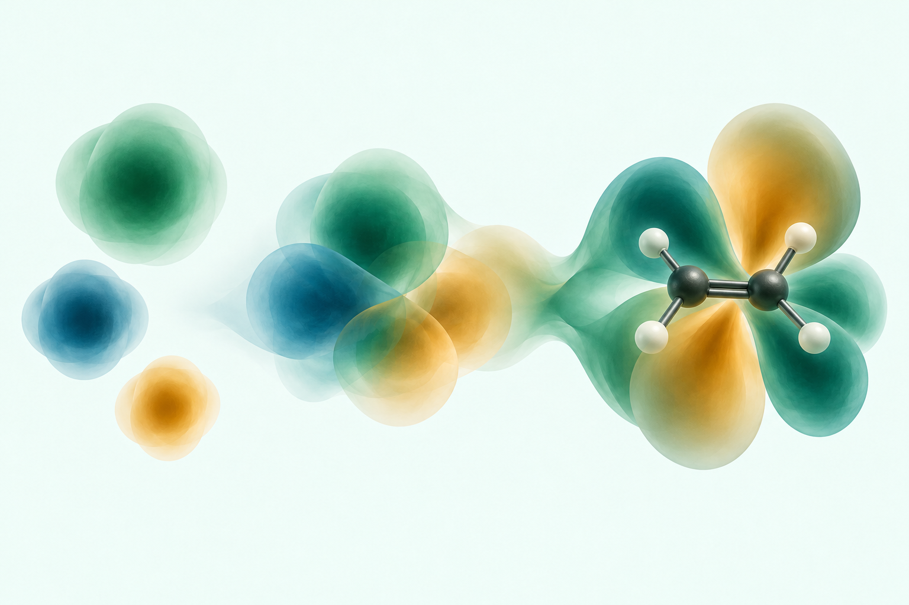

# Basis-to-molecule study with visible ethene (15 October 2026)

Review-only edit of option 3, generated with the built-in image tool using
`03-basis-to-molecule.png` as the edit target. The original image is retained.
The active chapter cover is unchanged, pending approval of this variant and
a cover-layout preview.

The added ball-and-stick framework represents ethene (two carbon atoms,
four hydrogen atoms, and a carbon-carbon double bond). The surrounding
colored shapes remain artistic: they are not computed ethene orbitals or
electron densities and do not establish orbital phases, nodal structure,
or a quantitative basis-function expansion. The left-to-right progression
is a visual metaphor for constructing a molecular description.

Visual review confirmed the two carbons, four hydrogens, double bond,
retained left-hand clouds, palette, and landscape framing.

## Final editing prompt

Use case: precise-object-edit. Input image: edit target, the approved direction-3 basis-to-molecule cover-art study. Preserve the landscape framing, pale mint background, left-hand three separate Gaussian-inspired clouds, the central overlapping transition, the emerald/petrol-blue/amber palette, soft translucent material, lighting and overall composition. Make one focused change on the RIGHT: place a clearly readable small ball-and-stick ETHENE molecule inside the large translucent molecular-orbital-inspired lobes. Ethene framework: exactly two dark charcoal carbon spheres linked by a visible double bond, each carbon attached to two smaller off-white hydrogen spheres, four hydrogens total, planar trigonal geometry at each carbon. Show the molecule at a gentle oblique angle while keeping its complete C2H4 connectivity readable. Render crisp slender dark-gray bonds with subtle dimensional lighting; make local cloud opacity low enough that the atoms and all six carbon-hydrogen/carbon-carbon bond cylinders (four C-H, two parallel C=C cylinders) can be seen through it. The molecular framework should be clearly visible and substantial, not a tiny hidden speck, but remain visually integrated within the existing right-hand lobes rather than placed separately below. Do not add any atoms, labels or framework to the left Gaussian forms. Keep existing surrounding shapes as close as practical; make only small local accommodations for molecular visibility. This is an artistic schematic, not a computed ethene orbital, not an electron-density map and not a quantitative Gaussian expansion. No text, letters, labels, equations, arrows, contour grids, watermark, frame or cover typography. Preserve original image dimensions and all original margins.
