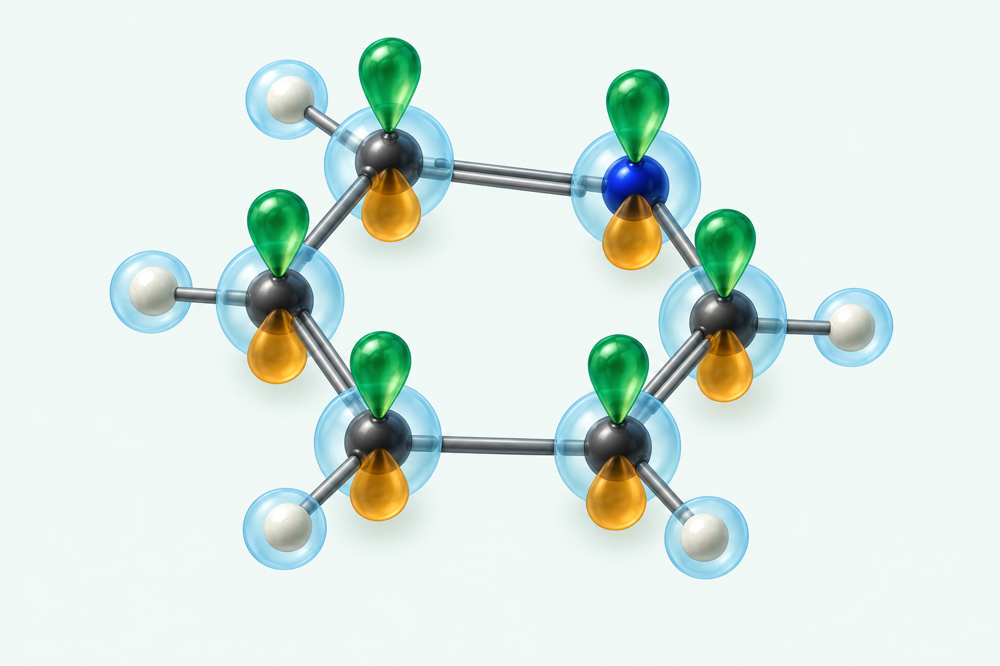

# Pyridine with atom-centered basis-function motifs (15 October 2026)

Review-only illustration generated with the built-in image tool in response
to the author's request for a nontrivial molecule with basis functions on
each atom. The active cover and all earlier previews remain unchanged.

The visible framework is pyridine: five charcoal carbon centers, one blue
nitrogen center, and five off-white hydrogen centers. Each heavy center has
a blue spherical envelope and a green/amber paired-lobe motif; each hydrogen
has a smaller spherical envelope. This explicitly shifts the emphasis from
a molecular cloud to local atom-centered functions.

These are selected schematic s- and p-type shapes, not the full functions
of a specified basis set. No exponents, normalization, contraction, radial
nodes, isovalue, optimized geometry, or numerical orbital calculation are
specified. The colors distinguish the two signs of the local p-type motif,
not a set of molecular-orbital coefficients. The image is an artistic
perspective illustration rather than a quantitative geometry diagram.

Visual review checked the six-membered ring, five carbons, one nitrogen,
five hydrogens, six paired-lobe motifs, and spherical motifs on all atoms.
Author approval and a cover-layout preview are still required before use.

## Final generation prompt

Use case: scientific-educational with refined sculptural editorial cover-art styling. Create a single original landscape illustration of ATOM-CENTERED BASIS FUNCTIONS on a clearly visible nontrivial molecule: PYRIDINE C5H5N. This replaces an earlier basis-to-molecule progression: now the molecule and the basis functions must occupy one coherent centered composition, with NO detached clouds or progression. Molecular framework: exactly one six-membered planar aromatic ring, FIVE charcoal carbon atoms and ONE deep-blue nitrogen atom at the sixth vertex, FIVE off-white small hydrogen atoms attached outward one to each carbon and NO hydrogen on nitrogen. Six ring bonds close a hexagon; use slender gray rods with alternating double-bond accents if readable. Entire 11-atom molecule visible, no atoms hidden or cropped. View the molecular plane obliquely from above, enough face-on that all six vertices and all five hydrogens are separately readable. ON EVERY heavy atom draw one compact translucent pale-petrol-blue spherical s-type Gaussian envelope centered EXACTLY on its nucleus, and ONE distinct p_z-type pair of teardrop lobes sharing that same nucleus as their central node, with their common axis perpendicular to the molecular plane. Six p-type pairs total, twelve lobes total: all upper lobes emerald green, all lower lobes warm amber, representing the SAME arbitrary sign convention for each LOCAL basis function, not a phase pattern of a molecular orbital. Keep lobes moderately small so their separate atom-centered origins remain apparent, with gentle overlap of neighbors but NO merging into a single molecular cloud. On EACH of the FIVE hydrogen atoms draw one smaller translucent pale-blue spherical s-type Gaussian envelope, exactly centered on its hydrogen sphere. Do NOT put p lobes on hydrogens. This is a selected s/p basis-function schematic, not all functions of a named basis set, not an electron-density map and not a computed molecular orbital. Scientific readability is paramount: make centers and bonds visible through the translucent shapes, especially rear ring vertices. Style: sophisticated soft dimensional frosted-glass illustration, smooth clean surfaces, subtle internal transparency, restrained studio lighting. Dominant deep emerald with blue and amber accents. Clean uniform very pale mint #F2F8F6 background and generous blank margins. Landscape aspect approximately 3:2, whole composition centered, rich but orderly, suitable for a Hartree-Fock and basis-set textbook cover. No text, labels, equations, arrows, captions, axes, mesh, contour lines, electron paths, decorative particles, watermarks or logos.
