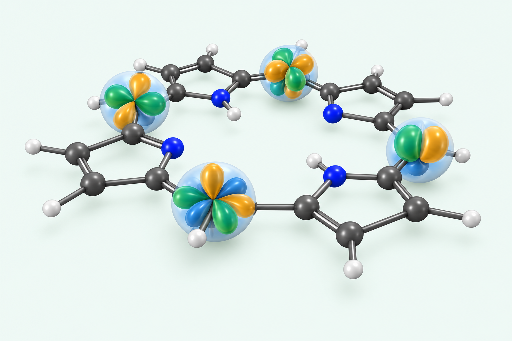

# Reference-based local-basis style study (15 October 2026)

Review-only image generated with the built-in image tool using the author's
attached screenshot as the structural and visual reference. It follows that
reference closely; it is not being presented as independently authored
molecular geometry or as evidence of reuse permission for the source image.
The screenshot's source and reuse status have not been established. The
original screenshot has not been copied into this repository.

This direction emphasizes a readable larger molecular framework with compact
angular motifs at selected centers, rather than the preceding pyridine
image's uniform large p-type pairs on every heavy atom. The chapter's
green/amber palette replaces the reference's red/blue orbital colors.

This is a visual-direction mockup only. Its molecular connectivity and its
lobes have not been numerically validated. In particular, the mixed colors
and angular clusters do not define genuine individual Gaussian functions,
orbital coefficients, or a specified basis set. It must not be described as
a computed basis-function or molecular-orbital rendering.

Before final scientific use, recreate the chosen design from verified
molecular coordinates and actual selected basis functions with documented
angular conventions, exponents/contractions, and isovalues. The source
reference also needs appropriate provenance if its composition is retained.
The active chapter cover remains unchanged, pending author approval.

## Final generation prompt

Use case: stylized-concept, scientific textbook cover illustration study. Input image 1 is a STRUCTURAL AND STYLE REFERENCE, not an image to recolor or trace pixel-for-pixel. Produce a fresh clean high-resolution 3D rendering inspired by its scientific-visualization language: a substantial planar nitrogen-containing macrocyclic ball-and-stick molecular framework, seen at a gently tilted oblique angle, with a clear central opening and compact localized atom-centered angular basis-function motifs at several well-spaced atomic sites. The key difference from an ordinary orbital cover is that the carbon/nitrogen/hydrogen framework dominates and remains READABLE, while separate small s/p/d-like groups are centered on chosen nuclei, as in the reference. Respect the reference's molecular connectivity as closely as possible; do not invent spurious atoms or floating bonds. Render charcoal carbon balls, blue nitrogen balls, small white hydrogens, slender gray bonds with clear single/double conventions. Show four or five compact local basis-function groups at different ring sites, varying in angular shape: one paired p-like group, two four-lobed cloverleaf d-like groups, one more intricate compact angular group. Every group must have a single atom center, balanced lobes and smooth modestly translucent surfaces, with smaller faint pale-blue spherical s-type envelopes at those same centers. Use emerald green and warm amber for opposite-sign lobes with restrained petrol-blue accents; no red/pink orbital lobes. Keep each cluster small enough that neighboring bonds and the macrocycle outline are visible; no giant all-enveloping molecular cloud, no uniform forest of identical p lobes on every atom, no detached Gaussian cloud progression. Place clusters with pleasing asymmetry and enough space between them. Maintain a calm refined scientific rendering aesthetic rather than bubbly glass art: smooth surfaces, restrained specular highlights, soft shadows, physically legible overlap and depth. Wide landscape approximately 3:2, complete molecule visible with generous empty margins, very pale mint background #F2F8F6. This is a schematic visual-direction mockup, not calculated basis functions, not a quantitatively verified molecular model, not a molecular orbital or density map. No letters, text, captions, title, labels, equations, arrows, contour maps, axes, grid, mesh, decorative particles, watermarks or logos.
