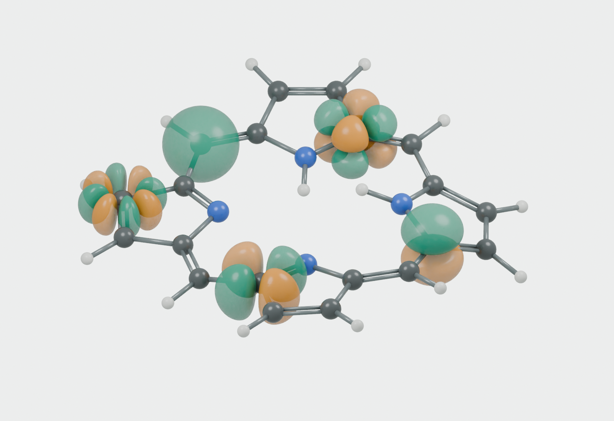

# Porphine with genuine s, p, d, f, and g Gaussian functions

Author-approved, reproducible scientific rendering (15 October 2026). This
supersedes the random angular motifs of the generated style study for
scientific accuracy. The author approved this design with "Excellent! Let's
use this." It is incorporated in the active chapter cover as
`chapter-figures/cover-porphine-gaussians.png`; the review images and editable
scene below are retained as the design and verification record.

## What is plotted

Each function has the explicit form `N P(x,y,z) exp(-alpha r^2)`, in local
coordinates relative to its own atomic center. `N` gives unit integral of
the squared function over three-dimensional space. The polynomials are
homogeneous harmonic polynomials of degrees 0 through 4: real pure-angular
solid-harmonic Gaussian functions, not arbitrary lobe arrangements.
Real-harmonic conventions and their relationship to spherical harmonics
are described in [NIST DLMF, section 14.30](https://dlmf.nist.gov/14.30).

| Type | Polynomial P | PubChem atom ID | alpha (inverse square angstrom) | Positive / negative components |
| --- | --- | --- | --- | --- |
| s | 1 | C14 | 2.0 | 1 / 0 |
| p_z | z | C8 | 3.0 | 1 / 1 |
| d_xy | xy | C19 | 3.0 | 2 / 2 |
| f_z(x2-y2) | z(x^2-y^2) | C5 | 4.2 | 4 / 4 |
| g_xy(x2-y2) | xy(x^2-y^2) | C21 | 5.2 | 4 / 4 |

Atom IDs refer to the archived PubChem atom identifiers, not a conventional
chemical numbering scheme. Green always denotes positive function values;
amber denotes negative values. The sign of an individual real function is
arbitrary, but the relative signs between its lobes are fixed by its
polynomial. The s function has no negative component. No additional
spherical shell has been added to the higher-angular-momentum functions.

Surfaces are at plus/minus 20% of each function's maximum absolute value
on the sampling grid. An 89-cubed grid covers [-2,2] angstrom in each local
coordinate. Tetrahedral extraction determines topology; analytic-gradient
projection places the mesh vertices on the exact level sets. The polygonal
mesh remains a finite-resolution approximation between vertices. Its
closedness, lobe counts, and vertex level-set residuals are checked.
The accompanying JSON records normalization constants, absolute isovalues,
atom centers, exponents, mesh sizes, component counts, and vertex errors.

These are genuine selected Gaussian **basis functions**, not occupied
atomic eigenstates or self-consistent molecular orbitals. In particular,
the f/g functions are higher-angular-momentum examples placed on carbon,
not a claim that carbon has occupied f/g valence orbitals. Exponents are
chosen for a readable illustration; this is not a named contracted basis
set, and no HF calculation or orbital occupation is implied.

## Molecular framework and provenance

Coordinates, atomic identities, connectivity, and bond orders come from
[PubChem CID 66868, porphine](https://pubchem.ncbi.nlm.nih.gov/compound/66868),
formula C20H14N4. The numerical 3D record was downloaded on 15 October 2026
and archived as `porphine-pubchem-3d.json`, using:

    https://pubchem.ncbi.nlm.nih.gov/rest/pug/compound/cid/66868/JSON?record_type=3d

The source conformer is recentered and rigidly rotated into its best-fit
heavy-atom molecular plane; its actual distortions are retained. It is
not claimed to be an HF-optimized structure. All atoms and bonds in the
scene are reconstructed from these numerical data. Neither the supplied
screenshot nor the preceding AI-generated raster is edited or used as
geometry, texture, or a compositing background. Their role was to establish
the general visual direction (molecular framework with selected local
functions).

## Verification and editable outputs

- Symbolic coefficient checks: the Laplacian of every angular polynomial
  vanishes and each has a single total degree.
- Independent 12-point-per-axis Gauss-Hermite quadrature verifies unit
  normalization to an absolute tolerance of 1e-12.
- Explicit nodal-plane tests for selected components.
- All signed meshes are closed two-manifolds with the expected connected
  lobe counts and sphere topology per lobe.
- Relative vertex isovalue residual below 1e-8; sampling-box boundary values
  are below the isovalue, preventing clipped surfaces.
- The scene contains 20 carbon, four nitrogen, and 14 hydrogen atoms.

`06-porphine-exact-gaussians.blend` is the editable native 3D scene, and the
2400-by-1650 PNG has a transparent background for eventual cover placement.
The companion `06-porphine-exact-gaussians-review.png` is a 1600-by-1100
light-background render of the same geometry for convenient inspection.
Source generation is in `scripts/render_basis_cover.py`. From the repository
root, with Blender 4.5 and its bundled NumPy:

    blender --background --python scripts/render_basis_cover.py

For a faster 1600-by-1100 transparent render, append `-- --quick`.
The separate light-background rendering uses `-- --opaque-preview`.
Function checks alone can also run with ordinary NumPy-enabled Python:

    python3 scripts/render_basis_cover.py -- --check

No image-generation model is used in this rendering. Cover integration
changes only the illustration; chapter text and derivations are unchanged.
