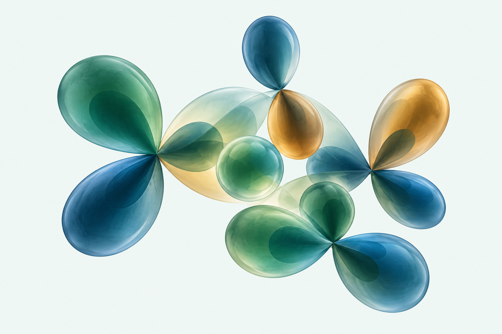
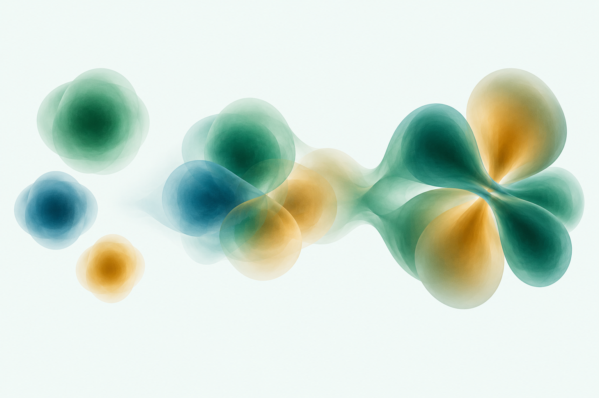

# Cover illustration studies (15 October 2026)

Design and approval records. Studies 1-5 are review-only concepts generated
with the image tool. Study 6 is a reproducible mathematical rendering,
approved by the author and incorporated in the chapter cover on 15 October
2026. The earlier unselected designs remain archived, not active.

The original three are artistic schematics, not calculated molecular orbitals,
electron densities, or identified molecular species. Ribbon crossings are a
visual metaphor for exchange, not a literal electron-trajectory diagram.
The Gaussian-to-molecule transition is conceptual rather than a quantitative
linear-combination demonstration. Any selected image needs author approval
and a cover-layout preview before incorporation.

The requested [option 3 variant with visible ethene](03b-basis-to-ethene.md)
adds an identifiable molecular framework while retaining schematic colored
lobes. It is also review-only; no computed ethene orbital is being claimed.

The subsequent [pyridine atom-centered basis study](04-pyridine-atom-centered-basis.md)
responds to the request for a nontrivial molecule with functions visible on
each atom. It shows selected schematic s/p shapes, not a complete named basis
set, and also remains review-only.

The [reference-based macrocycle style study](05-macrocycle-local-basis-style.md)
follows the author's supplied screenshot more closely: compact angular
clusters at selected centers on a readable larger framework. It is an
unvalidated visual mockup, not a computed scientific illustration; see its
provenance and final-rendering requirements before any incorporation.

The [mathematically rendered porphine preview](06-porphine-exact-gaussians.md)
now replaces invented lobe shapes with explicit normalized real s/p/d/f/g
Gaussian functions. It uses archived PubChem coordinates and a new native
3D scene, not an edited generated image. Formulae, exponents, isovalues,
verification, and reproducible source are documented with the preview.
The author approved study 6 on 15 October 2026. Its transparent render is now
the active cover illustration; the formulae, data, and editable native scene
remain available here for inspection and reproduction.

## 1. sculptural-orbitals

### Final generation prompt

Use case: stylized-concept. Asset type: landscape illustration study for the cover of a PhD-level textbook chapter on Hartree-Fock theory, basis sets and molecular integrals. Create one original, sophisticated scientific cover-art illustration, artwork only, no cover typography. Scene: clean very pale mint background #F2F8F6, flat uniform background extending to every edge, soft studio illumination. Subject: a sculptural floating arrangement of translucent three-dimensional s- and p-orbital-inspired forms: one small spherical form and several clearly paired smooth teardrop lobes, each p-like pair meeting at a common central node, arranged as a balanced overlapping abstract molecular composition. Dark emerald green and petrol blue, with a restrained warm amber accent; opposite phases may use contrasting colors. Materials: elegant frosted glass, transparent overlapping volumes, softly luminous edges, restrained dimensional shading, not glossy plastic. Composition: wide landscape, approximately 3:2, sculpture fully visible at center with generous blank margins, graceful depth from a slight oblique viewpoint. This is explicitly schematic art, not a computed molecular orbital or an identified molecule. Avoid contour lines, mesh grids, ball-and-stick molecules, electron planetary orbits, ribbons, equations, labels, letters, captions, watermarks, frames, logos and decorative stars. Polished original scientific editorial illustration, rich yet calm, suitable for print.

## 2. exchange-ribbons

### Final generation prompt

Use case: stylized-concept. Asset type: landscape illustration study for the cover of a PhD-level textbook chapter on Hartree-Fock theory. Create one original scientific cover-art illustration, artwork only, no cover typography. On a clean uniform very pale mint #F2F8F6 background, show a sculptural composition of four continuous broad silk-like ribbons that interweave and exchange positions with clearly legible over-and-under crossings. Suggest fermionic exchange and antisymmetry through the balanced exchange of paths, purely as an abstract visual metaphor, not a literal particle trajectory diagram. Ribbons begin and end in free tapered edges and form a graceful elongated spatial braid, with varying heights and breathing room between strands. Deep emerald green dominant, petrol blue secondary and a restrained amber ribbon, subtle translucency, satin surfaces, soft studio lighting and delicate shadows, sophisticated editorial 3D render. Wide landscape approximately 3:2, whole composition fully visible, centered with generous blank margins. Avoid DNA double helices, knots with impossible junctions, woven baskets, orbitals, contour maps, molecular balls, electrons, arrows, mathematical signs, equations, text, labels, logos, watermarks, frames and cosmic backgrounds. The image should feel thoughtful, fluid and original rather than decorative clipart.

## 3. basis-to-molecule

### Final generation prompt

Use case: stylized-concept. Asset type: landscape illustration study for a scientific textbook chapter cover linking basis functions to molecular orbitals. Create an original polished cover-art illustration, artwork only, without text. Very pale mint #F2F8F6 uniform background. A single connected left-to-right visual composition: on the left three distinct simple translucent Gaussian-inspired volumetric clouds of different sizes, emerald, petrol blue and warm amber, spatially separated; toward the center these smooth compact forms overlap; on the right they resolve visually into one richer coherent molecular-orbital-inspired sculptural cloud with smooth interlocking paired lobes and alternating emerald/amber phase regions. This is an artistic schematic of building a flexible molecular description from simpler basis functions, not an actual transformation simulation, computed orbital, electron density, or identified molecule. Keep the progression readily understandable through shape alone, without arrows or panels. Refined frosted-glass and softly diffuse volumetric material, subtle internal transparency, dimensional soft studio lighting, not smoke and not shiny plastic. Wide landscape approximately 3:2, entire flowing composition visible with generous margins. Maintain a restrained academic visual identity with dark green dominant. Avoid line graphs, contour maps, grids, mesh, plotted axes, text, labels, equations, arrows, watermarks, logos, frames, ball-and-stick models, planetary electron paths, cosmic particles and excessive glow.

